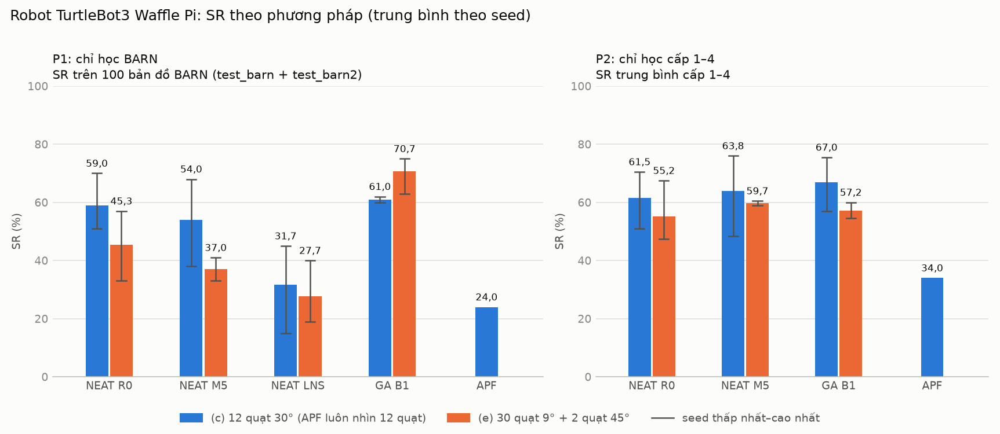

# Benchmark trên robot TurtleBot3 Waffle Pi: chỉ học BARN (P1) và chỉ học cấp 1–4 (P2)

Số liệu chốt ngày 27/11/2026: 44/44 lượt chạy đã xong, lượt cuối xong lúc 22:10. Báo cáo gồm hai giao thức: **P1** chỉ học BARN và **P2** chỉ học bộ bản đồ tự sinh cấp 1–4. Số từng seed và số tổng hợp: [benchmark/benchmark_waffle_results.json](benchmark/benchmark_waffle_results.json).

**Tóm tắt.**

- **P1: chỉ học BARN** (SR trên 100 bản đồ BARN, trung bình theo seed): nhánh NEAT cao nhất là R0 (c) với 59,0 %; GA B1 (c) 61,0 %, (e) 70,7 %; APF 24,0 %.
- **P2: chỉ học cấp 1–4** (SR trung bình cấp 1–4, trung bình theo seed): nhánh NEAT cao nhất là M5 (c) với 63,8 %; GA B1 (c) 67,0 %, (e) 57,2 %; APF 34,0 %.
- Với 3 seed mỗi nhánh, kiểm định hoán vị không thể cho p nhỏ hơn 0,1, nên không phép so nào ở mục 7 đạt mức 0,05. Chênh lệch rõ nhất là 4 phép so ở P1 mà mọi seed của nhánh NEAT thấp hơn mọi seed GA B1 cùng cảm biến (p = 0,1): NEAT R0 (e), NEAT M5 (e), NEAT LNS (c) và NEAT LNS (e).



Cột: SR trung bình theo seed; vạch: seed thấp nhất–cao nhất. P1: SR trên 100 bản đồ BARN (`test_barn` + `test_barn2`); P2: SR trung bình cấp 1–4.

## 1. Robot và cảm biến

Robot là bản mô phỏng rút gọn của TurtleBot3 Waffle Pi (chi tiết: [README](../README.md), mục 9):

- Lệnh là tốc độ tiến v ≤ 0,26 m/s (không lùi) và tốc độ quay |ω| ≤ 1,82 rad/s; mỗi bánh kẹp ±0,26669 m/s.
- Thân là đĩa va chạm r = 0,2077 m. LiDAR hình quạt, tầm 3,5 m. Tới đích khi tâm quay cách đích ≤ 0,30 m.
- Mỗi lượt tối đa 1.000 bước (100 s, Δt = 0,1 s).

Hai cách gộp tia LiDAR thành đầu vào của mạng. Mỗi quạt cho một giá trị theo khoảng cách nhỏ nhất tới vật cản trong quạt; thêm 3 đầu vào cho khoảng cách và hướng tới đích.

- **(c)** 12 quạt 30° đều quanh robot: 15 đầu vào.
- **(e)** 30 quạt 9° phủ 270° phía trước và 2 quạt 45° phía sau: 35 đầu vào.

APF không học và luôn nhìn 12 quạt như (c).

## 2. Giao thức

| | P1: chỉ học BARN | P2: chỉ học cấp 1–4 |
|:--|:--|:--|
| Dữ liệu học | 150 bản đồ BARN (`train/level_1`) trong `data/maps_barn` | 1.000 bản đồ tự sinh, 250 mỗi cấp (`train/level_1` … `train/level_4`) trong `data/maps` |
| Bản đồ mỗi thế hệ | 8 bản đồ bốc ngẫu nhiên từ 150 bản đồ học, dùng chung cho cả quần thể | 8 bản đồ: 2 bản đồ bốc ngẫu nhiên mỗi cấp, dùng chung cho cả quần thể |
| Quần thể × thế hệ | 150 × 150 | 150 × 150 |
| Ngân sách học | 180.000 lượt đánh giá mỗi lượt chạy | 180.000 lượt đánh giá mỗi lượt chạy |
| Chọn champion | Cứ 10 thế hệ, 5 cá thể có fitness huấn luyện cao nhất được chấm trên 50 bản đồ val BARN; giữ cá thể có khóa (SR val, fitness val) lớn nhất | Như P1, trên 100 bản đồ val (25 mỗi cấp, gộp chung) |
| Tập chấm | `test_barn` 50 bản đồ; `test_barn2` 50 world BARN khác (không trùng bản đồ học, val và `test_barn`); mê cung Lehman–Stanley 2 bản đồ | Cấp 1–4, mỗi cấp 50 bản đồ; `test_barn` 50 bản đồ (cùng 50 bản đồ với P1; dữ liệu học của P2 không có BARN); mê cung Lehman–Stanley 2 bản đồ |
| Seed | NEAT, GA: 3 seed (0, 1, 2); APF: chấm 1 lần | Như P1 |

Không chọn champion theo tập test. Ngoài 180.000 lượt đánh giá để học, mỗi lượt chạy NEAT và GA có thêm lượt val (3.750 ở P1, 7.500 ở P2). NEAT M5 và LNS chạy thêm bản đồ probe cố định (1 bản đồ ở P1, 4 bản đồ ở P2, mỗi cá thể mỗi thế hệ) chỉ để đo hành vi cho novelty: 22.500 lượt ở P1 và 90.000 lượt ở P2, không tính vào ngân sách.

## 3. Phương pháp

- **NEAT R0**: NEAT với mạng hồi quy, chọn lọc chỉ theo fitness, học đều (không curriculum). Mốc so sánh.
- **NEAT M5**: như R0, thêm novelty lai. Điểm chọn lọc = λ·fitness + (1 − λ)·novelty, cả hai chuẩn hóa theo thang cố định; λ bắt đầu 0,5, tăng tới 0,6, hạ về 0,2 khi fitness tốt nhất trì trệ. Hành vi là vị trí cuối trên các bản đồ probe.
- **NEAT LNS** (chỉ P1): novelty search thuần theo Lehman & Stanley (2011). Chọn lọc chỉ theo novelty; archive và ngưỡng theo luật của bài báo.
- **GA B1**: GA chỉ tiến hóa trọng số của mạng truyền thẳng cố định n–8–2 (n = 15 với (c), 35 với (e)). Chọn lọc cắt ngọn 20 %, giữ 1 cá thể tốt nhất, lai đều, đột biến Gauss mọi gen. Cùng fitness, cùng số bản đồ mỗi thế hệ, cùng ngân sách và cùng cách chọn champion với NEAT.
- **APF**: trường thế nhân tạo (lực hút về đích, lực đẩy từ vật cản). Không học, tất định nên chấm một lần.

Mọi nhánh NEAT và GA chọn champion theo SR val như mục 2, kể cả M5 và LNS.

## 4. Chỉ số

- **SR**: tỉ lệ lượt tới đích trước khi va chạm và trước khi hết giờ.
- **CR**: tỉ lệ lượt kết thúc vì va chạm. Lượt dừng ngay ở va chạm đầu tiên.
- **TC**: số lượt kết thúc vì va chạm, tức tổng số va chạm trên tập (= CR × số bản đồ).
- **Hết giờ**: tỉ lệ lượt không tới đích, không va chạm sau 1.000 bước. SR + CR + hết giờ = 100 %.
- **SPL**: trung bình trên mọi lượt của S·l/max(p, l). S = 1 nếu tới đích, ngược lại 0; l là độ dài đường A* ngắn nhất (đã làm mượt) ghi trong file bản đồ; p là quãng đường robot đã đi.
- **MTT**: thời gian trung bình (giây) tới đích, chỉ tính lượt tới đích.
- **SR val**: SR của champion trên bản đồ val. Đây là khóa chọn champion, không phải số test.

Nhiều seed: SR, CR, hết giờ, SPL lấy trung bình theo seed, kèm [seed thấp nhất–cao nhất] ở các cột SR chính. TC là trung bình mỗi seed. MTT gộp mọi lượt tới đích của các seed.

## 5. Kết quả P1: chỉ học BARN

Bảng 1. SR (%) trên `test_barn`, `test_barn2` và cả 100 bản đồ BARN. Các cột CR, hết giờ (%), TC, SPL, MTT tính trên 100 bản đồ. TC là số lượt va chạm trung bình mỗi seed (trên 100 lượt, nên bằng CR tính theo %), trong ngoặc là tổng của các seed. SR val trên 50 bản đồ val.

| Nhánh | Seed | SR test_barn | SR test_barn2 | SR 100 bản đồ | CR | Hết giờ | TC (tổng) | SPL | MTT (s) | SR val |
|:--|--:|--:|--:|--:|--:|--:|--:|--:|--:|--:|
| NEAT R0 (c) | 3 | 66,7 [58–80] | 51,3 [44–60] | 59,0 [51–70] | 40,7 | 0,3 | 40,7 (122) | 0,484 | 53,9 | 66,7 |
| NEAT R0 (e) | 3 | 48,7 [36–64] | 42,0 [30–50] | 45,3 [33–57] | 53,3 | 1,3 | 53,3 (160) | 0,403 | 55,6 | 51,3 |
| NEAT M5 (c) | 3 | 51,3 [38–62] | 56,7 [38–74] | 54,0 [38–68] | 45,0 | 1,0 | 45,0 (135) | 0,527 | 43,8 | 60,7 |
| NEAT M5 (e) | 3 | 38,0 [32–44] | 36,0 [34–38] | 37,0 [33–41] | 63,0 | 0,0 | 63,0 (189) | 0,365 | 47,4 | 39,3 |
| NEAT LNS (c) | 3 | 31,3 [14–46] | 32,0 [16–44] | 31,7 [15–45] | 65,3 | 3,0 | 65,3 (196) | 0,291 | 58,2 | 43,3 |
| NEAT LNS (e) | 3 | 31,3 [22–46] | 24,0 [12–34] | 27,7 [19–40] | 70,7 | 1,7 | 70,7 (212) | 0,202 | 72,3 | 30,0 |
| GA B1 (c) | 3 | 62,7 [60–68] | 59,3 [56–62] | 61,0 [60–62] | 39,0 | 0,0 | 39,0 (117) | 0,550 | 41,7 | 70,7 |
| GA B1 (e) | 3 | 75,3 [60–86] | 66,0 [64–68] | 70,7 [63–75] | 29,3 | 0,0 | 29,3 (88) | 0,623 | 42,6 | 70,0 |
| APF (c) | 1 | 20,0 | 28,0 | 24,0 | 0,0 | 76,0 | 0,0 (0) | 0,234 | 74,5 | – |

Mê cung Lehman–Stanley (2 bản đồ): không nhánh nào tới đích ở seed nào (SR 0 %). Mọi lượt của các nhánh học kết thúc vì va chạm; APF hết giờ ở cả hai mê cung.

## 6. Kết quả P2: chỉ học cấp 1–4

Bảng 2. SR (%) theo cấp, trung bình cấp 1–4 [seed thấp nhất–cao nhất] và SR trên `test_barn` (cùng 50 bản đồ BARN với P1, không có trong dữ liệu học của P2). SR val trên 100 bản đồ val.

| Nhánh | Seed | Cấp 1 | Cấp 2 | Cấp 3 | Cấp 4 | TB cấp 1–4 | BARN (chưa học) | SR val |
|:--|--:|--:|--:|--:|--:|--:|--:|--:|
| NEAT R0 (c) | 3 | 96,0 | 83,3 | 32,0 | 34,7 | 61,5 [51–70,5] | 26,0 | 63,3 |
| NEAT R0 (e) | 3 | 95,3 | 72,7 | 28,7 | 24,0 | 55,2 [47,5–67,5] | 8,0 | 55,3 |
| NEAT M5 (c) | 3 | 94,7 | 76,7 | 32,7 | 51,3 | 63,8 [48,5–76] | 28,7 | 64,3 |
| NEAT M5 (e) | 3 | 96,7 | 66,7 | 36,0 | 39,3 | 59,7 [59–60,5] | 17,3 | 62,0 |
| GA B1 (c) | 3 | 95,3 | 77,3 | 44,0 | 51,3 | 67,0 [57–75,5] | 21,3 | 64,7 |
| GA B1 (e) | 3 | 90,7 | 70,0 | 26,7 | 41,3 | 57,2 [54,5–60] | 9,3 | 61,0 |
| APF (c) | 1 | 100,0 | 36,0 | 0,0 | 0,0 | 34,0 | 20,0 | – |

Bảng 3. CR / hết giờ (%) theo cấp, và các chỉ số của cả 4 cấp (200 lượt mỗi seed). TC là số lượt va chạm trung bình mỗi seed trên 200 lượt, trong ngoặc là tổng của các seed.

| Nhánh | Cấp 1: CR / hết giờ | Cấp 2: CR / hết giờ | Cấp 3: CR / hết giờ | Cấp 4: CR / hết giờ | CR 4 cấp | Hết giờ 4 cấp | TC 4 cấp (tổng) | SPL 4 cấp | MTT 4 cấp (s) |
|:--|--:|--:|--:|--:|--:|--:|--:|--:|--:|
| NEAT R0 (c) | 0,0 / 4,0 | 8,7 / 8,0 | 48,0 / 20,0 | 50,0 / 15,3 | 26,7 | 11,8 | 53,3 (160) | 0,513 | 49,3 |
| NEAT R0 (e) | 0,0 / 4,7 | 18,0 / 9,3 | 41,3 / 30,0 | 65,3 / 10,7 | 31,2 | 13,7 | 62,3 (187) | 0,468 | 45,8 |
| NEAT M5 (c) | 0,0 / 5,3 | 7,3 / 16,0 | 30,0 / 37,3 | 38,7 / 10,0 | 19,0 | 17,2 | 38,0 (114) | 0,508 | 55,5 |
| NEAT M5 (e) | 0,0 / 3,3 | 18,7 / 14,7 | 26,0 / 38,0 | 47,3 / 13,3 | 23,0 | 17,3 | 46,0 (138) | 0,497 | 50,5 |
| GA B1 (c) | 1,3 / 3,3 | 10,0 / 12,7 | 32,7 / 23,3 | 34,0 / 14,7 | 19,5 | 13,5 | 39,0 (117) | 0,562 | 44,3 |
| GA B1 (e) | 2,0 / 7,3 | 7,3 / 22,7 | 33,3 / 40,0 | 35,3 / 23,3 | 19,5 | 23,3 | 39,0 (117) | 0,456 | 45,7 |
| APF (c) | 0,0 / 0,0 | 0,0 / 64,0 | 0,0 / 100,0 | 0,0 / 100,0 | 0,0 | 66,0 | 0,0 (0) | 0,335 | 59,7 |

Mê cung Lehman–Stanley (2 bản đồ): không nhánh nào tới đích ở seed nào (SR 0 %). Mọi lượt của các nhánh học kết thúc vì va chạm; APF hết giờ ở cả hai mê cung.

## 7. Cách đọc

- **Ít seed.** Mỗi nhánh học có 3 seed; APF tất định nên chấm một lần. SR trên tập chính chênh giữa các seed của cùng nhánh tới 30,0 điểm ở P1 (NEAT M5 (c): 38–68 %; NEAT LNS (c): 15–45 %) và 27,5 điểm ở P2 (NEAT M5 (c): 48,5–76 %). Vì vậy chênh lệch vài điểm giữa hai nhánh chưa kết luận được.
- **Kiểm định.** Kiểm định hoán vị chính xác hai phía trên SR từng seed của tập chính (P1: 100 bản đồ BARN; P2: TB cấp 1–4): xét mọi cách chia lại nhãn các seed của hai nhánh, p = min(1; 2 × p một phía nhỏ hơn). Với 3 so với 3 seed chỉ có 20 cách chia, nên p không thể nhỏ hơn 0,1: không phép so nào đạt mức 0,05. Trong 14 phép so dưới đây, 4 phép so có mọi seed bên này cao hơn mọi seed bên kia (p = 0,1).

  Bảng 4. Chênh lệch SR (điểm %, A trừ B) và p.

  | A so với B | P1 (c) | P1 (e) | P2 (c) | P2 (e) |
  |:--|--:|--:|--:|--:|
  | NEAT R0 so với GA B1 | −2,0; p = 0,80 | −25,3; p = 0,10 | −5,5; p = 0,60 | −2,0; p = 0,90 |
  | NEAT M5 so với GA B1 | −7,0; p = 0,70 | −33,7; p = 0,10 | −3,2; p = 0,70 | +2,5; p = 0,30 |
  | NEAT LNS so với GA B1 | −29,3; p = 0,10 | −43,0; p = 0,10 | – | – |
  | NEAT M5 so với NEAT R0 | −5,0; p = 0,70 | −8,3; p = 0,40 | +2,3; p = 0,80 | +4,5; p = 0,40 |

- **Lượt hỏng do đâu.** P1 (100 bản đồ BARN): ở các nhánh học, 95,6–100 % lượt hỏng là va chạm, phần còn lại hết giờ. APF không va chạm lần nào: mọi lượt hỏng của APF là hết giờ (76,0 % số lượt).
  P2 (cấp 1–4): lượt hỏng của các nhánh học gồm cả va chạm lẫn hết giờ; va chạm chiếm 45,5–69,5 % số lượt hỏng của 4 cấp. Theo cấp, phần va chạm là cấp 1: 0–28,6 %; cấp 2: 24,4–65,9 %; cấp 3: 40,6–70,6 %; cấp 4: 60,2–86,0 %. Phần va chạm nhìn chung tăng theo cấp: thấp nhất ở cấp 1 và cao nhất ở cấp 4 ở mọi nhánh học. Riêng NEAT R0 (e) và NEAT M5 (e), phần va chạm ở cấp 3 thấp hơn cấp 2 (57,9 % so với 65,9 %; 40,6 % so với 56,0 %). APF không va chạm lần nào; ở cấp 3 và 4, mọi lượt APF hết giờ.
- **Học BARN hay không.** Trên cùng 50 bản đồ `test_barn`, cả 6 nhánh học có ở hai giao thức đều đạt SR cao hơn khi học BARN (P1) so với khi chỉ học cấp 1–4 (P2): hơn 20,7–66,0 điểm. APF không học nên như nhau ở hai giao thức (20,0 %).
- **So với robot cũ** (chỉ để tham khảo). Robot cũ là đĩa r = 0,25 m, lệnh hai bánh ±0,5 m/s, LiDAR 3 m, 500 bước mỗi lượt; phép so vì thế là so hai gói robot + cảm biến, không chỉ so robot. Nguồn robot cũ: P2 là đợt 5 ([benchmark_sau_sua_loi.md](benchmark_sau_sua_loi.md), cùng giao thức P2); P1 là một đợt chạy trước với robot cũ theo đúng giao thức P1 (cùng `data/maps_barn`, quần thể 150 × 150 thế hệ, 8 bản đồ mỗi thế hệ, chọn champion theo 50 bản đồ val BARN), số của đợt này chưa có báo cáo riêng trong repo; APF không học nên dùng số chấm APF robot cũ của đợt 5.

  Bảng 5. SR (%) trung bình theo seed: Waffle với cảm biến (c) so với robot cũ.

  | Phương pháp | P1 test_barn: Waffle (c) | P1 test_barn: robot cũ | P2 TB cấp 1–4: Waffle (c) | P2 TB cấp 1–4: robot cũ | P2 BARN: Waffle (c) | P2 BARN: robot cũ |
  |:--|--:|--:|--:|--:|--:|--:|
  | NEAT R0 | 66,7 | 52,7 | 61,5 | 55,1 | 26,0 | 24,0 |
  | GA B1 | 62,7 | 39,3 | 67,0 | 59,0 | 21,3 | 14,7 |
  | APF | 20,0 | 34,0 | 34,0 | 34,5 | 20,0 | 34,0 |

  Cảm biến và seed của robot cũ: NEAT R0 (P1: đợt chạy trước, 12 quạt, seed 0–2; P2: đợt 5, 12 tia điểm, seed 0–3); GA B1 (P1: đợt chạy trước, 12 tia điểm, seed 0–2; P2: đợt 5, 12 tia điểm, seed 0–2); APF (P1: đợt 5, 12 tia điểm; P2: đợt 5, 12 tia điểm).

  Ở P2, đợt 5 còn có NEAT R0 của robot cũ với 12 quạt (biến thể R0_sec12, seed 0–3; [benchmark_sau_sua_loi.md](benchmark_sau_sua_loi.md) nêu tên biến thể này nhưng không đưa số vào bảng): TB cấp 1–4 51,1 %, BARN 28,5 %. So với bản 12 quạt này, NEAT R0 trên Waffle (c) cao hơn ở TB cấp 1–4 (61,5 so với 51,1) nhưng thấp hơn trên BARN (26,0 so với 28,5).

## 8. Chạy lại

Benchmark gọi `NEATRunner` (như `scripts/train_neat.py`) và `scripts/run_baselines.py`, rồi chấm champion bằng cùng hàm chấm với `scripts/evaluate.py`. Các lệnh dưới đây là cách chạy tương đương bằng script của repo. Biến môi trường phải đặt TRƯỚC khi chạy (cách đặt trong PowerShell: README, mục 9).

```bash
# (c): config gốc, 15 đầu vào
export NEAT_ROBOT=waffle NEAT_LIDAR_MODE=sector NEAT_LIDAR_N=12; unset NEAT_SECTOR_LAYOUT
CFG=configs/neat_recurrent.ini; S=c
# (e): 35 đầu vào
# export NEAT_ROBOT=waffle NEAT_LIDAR_MODE=sector NEAT_LIDAR_N=32 NEAT_SECTOR_LAYOUT=e32
# CFG=configs/neat_recurrent_n32.ini; S=e

for k in 0 1 2; do
  # P1, NEAT R0. NEAT M5 (P1 và P2): thay --no-novelty bằng --novelty, R0_ bằng M5_ ở --output-dir, --run-dir.
  # NEAT LNS (chỉ P1): thay --no-novelty bằng --novelty --novelty-rule lehman, R0_ bằng LNS_.
  python scripts/train_neat.py --config $CFG --data-dir data/maps_barn --levels 1 --generations 150 \
      --maps-per-eval 8 --no-novelty --no-curriculum --seed $k --backend gpu --output-dir output/waffle/P1/R0_$S/seed_$k
  python scripts/evaluate.py --run-dir output/waffle/P1/R0_$S/seed_$k --data-dir data/maps_barn \
      --sets test_barn,test_barn2,test_lehman --backend gpu
  # P1, GA B1: run_baselines.py tự chấm test_barn, test_lehman; test_barn2 chấm thêm bằng evaluate.py
  python scripts/run_baselines.py --baseline ga_b1 --seed $k --generations 150 --maps-per-eval 8 \
      --data-dir data/maps_barn --levels 1 --backend gpu --output-dir output/waffle/P1/ga_b1_$S/seed_$k
  python scripts/evaluate.py --mlp-params output/waffle/P1/ga_b1_$S/seed_$k/champion_params.npz \
      --data-dir data/maps_barn --sets test_barn2 --backend gpu --out output/waffle/P1/ga_b1_$S/seed_$k/test_barn2.json
  # P2: dữ liệu mặc định data/maps, bỏ --levels; evaluate.py chấm mặc định cấp 1–4, test_barn, test_lehman
  python scripts/train_neat.py --config $CFG --generations 150 --maps-per-eval 8 --no-novelty --no-curriculum \
      --seed $k --backend gpu --output-dir output/waffle/P2/R0_$S/seed_$k
  python scripts/evaluate.py --run-dir output/waffle/P2/R0_$S/seed_$k --backend gpu
  python scripts/run_baselines.py --baseline ga_b1 --seed $k --generations 150 --maps-per-eval 8 \
      --backend gpu --output-dir output/waffle/P2/ga_b1_$S/seed_$k
done

# APF: chỉ với biến của (c); không học, chấm một lần
python scripts/run_baselines.py --baseline apf --data-dir data/maps_barn --backend gpu --output-dir output/waffle/P1/apf
python scripts/evaluate.py --controller apf --data-dir data/maps_barn --sets test_barn2 --backend gpu \
    --out output/waffle/P1/apf/test_barn2.json
python scripts/run_baselines.py --baseline apf --backend gpu --output-dir output/waffle/P2/apf
```

`--backend gpu` cần CuPy (README, mục 8). Không có GPU thì bỏ `--backend` (mặc định `cpu`) hoặc dùng `--backend batch --workers 4`; theo README mục 8, các cách đánh giá cho cùng kết quả từng bit khi chạy trong cùng môi trường Python/NumPy. Benchmark đặt thêm `NEAT_EVAL_STRICT=1` (tự kiểm theo lô không đạt thì dừng, không quay về `cpu`); dùng `gpu` cho mọi lượt P1, `batch` cho NEAT R0 (c), NEAT M5 (c), GA B1 (c), APF (c) ở P2 và `gpu` cho các lượt còn lại.

Đã thử ngày 27/11/2026: các lệnh `train_neat.py` ở trên (NEAT R0, M5, LNS) và `run_baselines.py` (GA B1), chạy 3 thế hệ cho P1, cảm biến (c), seed 0, với `--backend batch --workers 4`, cho đúng các số của 3 thế hệ đầu trong `training_history.json` của lượt benchmark tương ứng. Cũng với `--backend batch --workers 4` và seed 0: `evaluate.py --run-dir` (P1 NEAT R0 (c); P2 NEAT R0 (e) với các tập mặc định), `--mlp-params` (P1 GA B1 (e), `test_barn2`), `--controller apf` (P1, `test_barn2`) và `run_baselines.py --baseline apf` (P2) cho đúng số trong `test_results.json` của benchmark; 1 thế hệ P2 cho NEAT R0 (c), GA B1 (c) và NEAT M5 (e) cho đúng các số huấn luyện của thế hệ đầu.

## 9. Kiểm số liệu

- Mỗi lượt đã xong được kiểm trước khi đưa vào bảng: cấu hình trong `job.json`, `summary.json` đúng giao thức; SR + CR + hết giờ = 100 %; n, TC, số lượt tới đích, SPL và MTT tính lại từ từng lượt trong `test_episodes.json` khớp `test_results.json`; mọi lượt hết giờ dừng đúng ở 1.000 bước.
- P1: `test/level_1` của `data/maps_barn` là bản sao từng byte của `test_barn`; hai tập cho cùng kết quả ở mọi lượt, nên bảng chỉ ghi `test_barn`.
- GA B1 và APF: champion được chấm lại bằng cùng hàm chấm với NEAT trên mọi tập; số chấm lại khớp số `run_baselines.py` tự chấm ở mọi tập chung.
- Mọi lượt chạy dùng cùng một bản sao mã (băm cây `src`, `configs`, `scripts`: `590c095ac647…`, ghi đủ trong file JSON).
- Mã của nhánh này có thêm vài thay đổi sau bản sao đó nhưng không đổi kết quả: cờ `--backend` và `--inexact` cho `train_neat.py`, `evaluate.py` và `run_ablation.py`; các trường TC, MTT (hàng trung bình cấp 1–4) và backend trong file kết quả; cột TC, nhãn `test_barn2` và số bước tối đa theo robot trong bảng và hình; kiểm robot và cảm biến trong `evaluate.py`; khúc tính LiDAR theo lô nhỏ hơn. Ngoài các thay đổi đó, mã chỉ khác ở chú thích và ở file cấu hình không dùng trong benchmark. Bản sao chưa có cờ `--backend` ở `train_neat.py` và `evaluate.py`, nên các lệnh ở mục 8 cần mã của nhánh này; các phép thử ghi ở mục 8 chạy bằng mã của nhánh và cho đúng số của benchmark.
