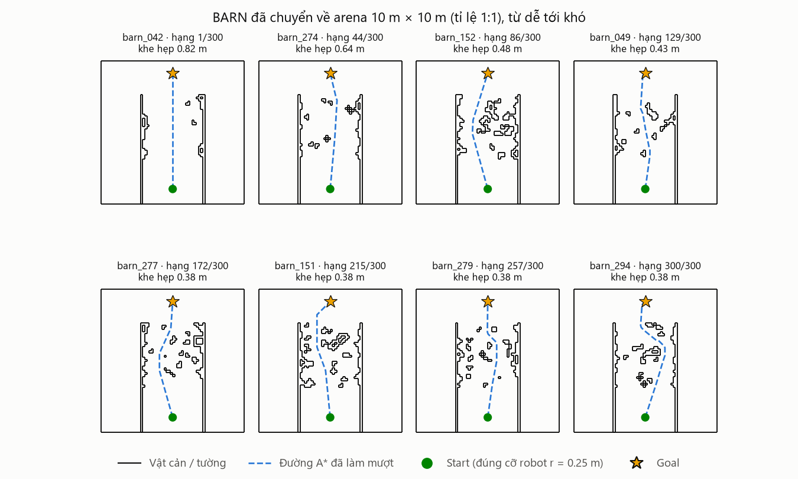
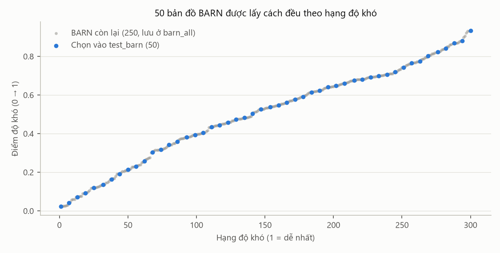
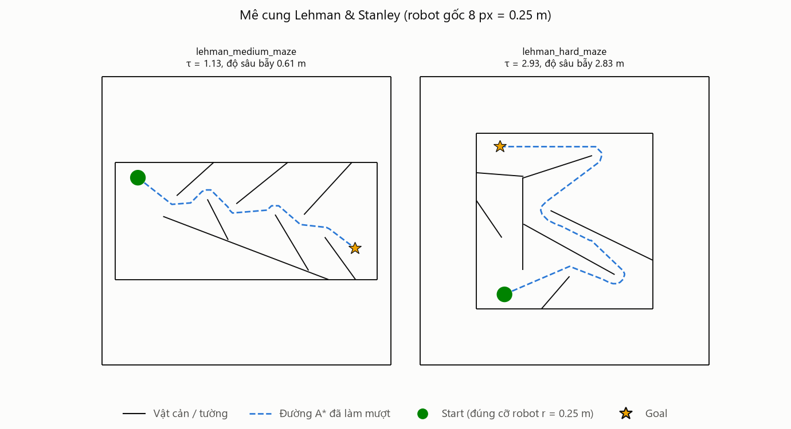
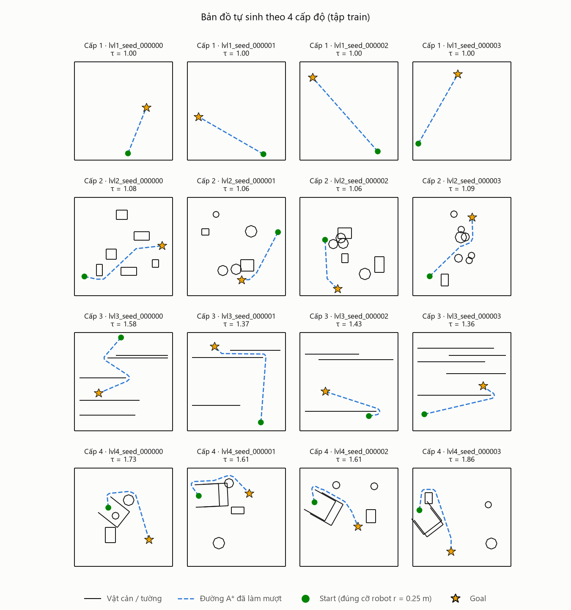
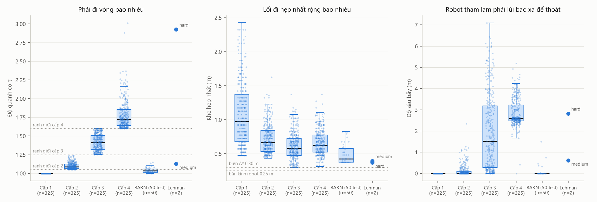

# Tiền xử lý dữ liệu bản đồ

Phần dữ liệu của đề tài *Điều hướng robot tự hành trong môi trường có vật cản bằng NEAT*
(IT4906 – Tính toán tiến hóa). Mọi con số dưới đây lấy từ lần chạy ngày 27/10/2026
(`reports/data/summary.json`, `data/maps/manifest.csv`); chạy lại các script sẽ ra đúng các số này.

## 1. Tóm tắt

- Dữ liệu của đề tài là **các bản đồ môi trường**: arena 10 m × 10 m, vật cản dạng đoạn thẳng,
  một điểm Start và một điểm Goal. NEAT không học từ nhãn mà chấm điểm genome bằng mô phỏng trên
  các bản đồ này. Vì vậy "tiền xử lý" ở đây gồm: lấy hoặc sinh bản đồ, đưa về cùng một định dạng
  JSON, loại bản đồ hỏng, đo độ khó, chia tập và kiểm tra rò rỉ giữa các tập.
- Dùng **2 bộ dữ liệu công khai** đúng như overview §5.2 đã dự kiến cho tập test đặc biệt:
  - **BARN** (Perille và cộng sự, 2020): 300 môi trường được chuyển về định dạng của dự án ở tỉ lệ thật 1:1.
    Robot của nhóm (r = 0,25 m) đi lọt cả 300. Chọn **50 bản đồ** trải đều từ dễ tới khó làm `test_barn`.
  - **Mê cung medium và hard của Lehman & Stanley (2011)**, bài báo gốc của Novelty Search → `test_lehman`.
- **Bộ bản đồ tự sinh** (1.000 train + 100 val + 200 test, 4 cấp) được sinh lại sau khi sửa các lỗi
  trong `generator.py`. Lỗi nặng nhất là **seed của các tập chồng nhau**: chạy code gốc thì 40/50
  bản đồ test cấp 1 và 41/48 bản đồ test cấp 3 giống hệt một bản đồ train.
- Sau tiền xử lý, cả 1.602 bản đồ (1.300 tự sinh + 300 BARN + 2 mê cung) đều qua đủ các bước kiểm tra:
  A* có đường, τ đúng dải cấp, S/G đủ thoáng, không trùng giữa các tập, và **robot bám theo đường A* trong
  chính `RobotNavEnv` tới được đích trong 500 bước** (1.602/1.602).

## 2. Ba nguồn bản đồ

| Nguồn | Số bản đồ | Thư mục | Dùng để |
|---|---|---|---|
| Tự sinh, 4 cấp độ (Empty, Sparse, Corridors, U-Traps) | 1.000 train, 100 val, 200 test | `data/maps/{train,val,test}/level_k/` | Huấn luyện, chọn cấp curriculum (val), test chính |
| BARN (công khai) | 300 → chọn 50 | `data/maps/test_barn/` (50), `data/maps/barn_all/` (300) | Câu hỏi Q3: tổng quát hoá zero-shot |
| Mê cung Lehman & Stanley (công khai) | 2 | `data/maps/test_lehman/` | Test bẫy đánh lừa kinh điển của Novelty Search |

Bản đồ công khai **chỉ dùng để test**, không đưa vào train/val, để câu trả lời cho Q3 là zero-shot thật.

## 3. Cách chạy lại

Bộ bản đồ đã xử lý có sẵn trong `data/maps/`. Muốn tạo lại từ đầu thì chạy từ thư mục gốc `robot-neat`,
trong môi trường ảo đã cài `requirements.txt` (đã thử với Python 3.14, neat-python 2.0.0, pygame-ce):

```bash
python scripts/download_public_data.py   # tải ~31 MB, giải nén ~170 MB vào data/raw/ (1 lần)
python scripts/pregenerate_maps.py       # sinh 1.300 bản đồ, ~26 phút (riêng cấp 4 ~19 phút)
python scripts/preprocess_data.py        # tiền xử lý + kiểm tra + hình, ~3 phút
```

- Hai nguồn công khai được cố định theo mã commit trong `download_public_data.py`, nên ai tải lại cũng ra
  đúng các file đã dùng (đã kiểm tra: khớp từng byte). Nguồn và giấy phép ghi trong `data/raw/SOURCES.txt`.
- `data/raw/` không cần đưa lên git (đã thêm vào `.gitignore`).
- Python 3.14 chưa có bản cài sẵn của `pygame`; dùng `pip install pygame-ce` (bản thay thế, code vẫn
  `import pygame`). Tiền xử lý không cần pygame.

## 4. Dữ liệu công khai

### 4.1. BARN – Benchmark for Autonomous Robot Navigation

**Nguồn.** 300 world Gazebo trong repo The BARN Challenge (giấy phép MIT), là bộ môi trường của bài báo
Perille và cộng sự (2020). Trang gốc của bộ dữ liệu (cs.utexas.edu) không truy cập được lúc làm, nên lấy
từ repo của cuộc thi, nơi dùng đúng 300 môi trường này.

**Cấu trúc gốc.** Mỗi vật cản là một trụ tròn bán kính 0,075 m đặt ở tâm một ô lưới 0,15 m. Đọc cả 300 file
cho thấy world nào cũng là lưới 30 ô (trục x) × 64 ô (trục y):

| Vùng lưới | Ý nghĩa |
|---|---|
| cột i = 0 và i = 29 | tường hai bên hành lang (rộng 4,5 m) |
| hàng j = 0 | tường phía sau điểm xuất phát |
| hàng j = 1…33 | đoạn chạy đà, không có vật cản |
| hàng j = 34…63 | vùng vật cản 30 × 30 ô sinh bằng cellular automaton (mật độ 3–25%, trung vị 12,4%) |

Robot Jackal xuất phát tại (−2,25; 3,0) quay mặt về +y, đích ở (−2,25; 13,0), tức 3,4 m sau vùng vật cản.

**Các bước chuyển đổi** (`src/maps/public_maps.py`):

1. Đọc file `.world` (XML) lấy toạ độ các trụ → lưới chiếm chỗ 30 × 64.
2. **Giữ tỉ lệ thật 1:1.** Robot Jackal rộng 0,43 m, dài 0,51 m; robot của nhóm có đường kính 0,5 m, gần bằng,
   nên không co giãn. Nhờ vậy BARN vẫn giữ đúng độ khó vốn có (khe hẹp so với cỡ robot).
3. Cắt bớt đoạn chạy đà để vừa arena 10 m: hành lang đặt giữa arena (x từ 2,75 tới 7,25 m), Start cách mép
   vùng vật cản 2,1 m như bản gốc, Goal đặt 1,5 m sau vùng vật cản (bản gốc là 3,4 m, không đủ chỗ).
4. Đổi lưới thành đoạn thẳng: mỗi cạnh nằm giữa một ô vật cản và một ô trống là một phần đường biên; các cạnh
   liền nhau trên một đường thẳng được gộp thành một đoạn. Kết quả 54–278 đoạn mỗi bản đồ (trung vị 160),
   trong khi nếu vẽ mỗi trụ bằng bát giác như `circle_to_segments` thì cần khoảng 2.080 đoạn. LiDAR quét
   12 tia × M đoạn mỗi bước nên số đoạn ít thì mô phỏng nhanh hơn nhiều.
5. Chạy A* với cùng thông số của dự án (lưới 5 cm, vật cản phình 0,30 m) và đo các chỉ số ở mục 7.

**Kết quả.** Robot của nhóm đi lọt **300/300** bản đồ. Khe hẹp nhất phải đi qua là 0,375–0,825 m tính từ tâm
đường đi tới vật cản (trung vị 0,425 m), tức lối đi hẹp nhất rộng 0,75 m so với robot rộng 0,5 m. Độ quanh co
τ của BARN chỉ 1,00–1,24 (trung vị 1,04): độ khó của BARN nằm ở **lối đi hẹp và dày vật cản**, không phải ở
đường vòng. Vì vậy trường `difficulty_level` (xếp theo τ) của BARN chỉ để tham khảo.

**Chọn 50 bản đồ test.** Điểm khó của mỗi bản đồ là trung bình thứ hạng của 3 chỉ số: độ thoáng trung bình dọc
đường đi (càng nhỏ càng khó), khe hẹp nhất (càng nhỏ càng khó), τ (càng lớn càng khó). Xếp 300 bản đồ từ dễ tới
khó rồi lấy 50 vị trí cách đều nhau, nên tập test phủ đủ từ dễ tới khó và không có yếu tố ngẫu nhiên. Mỗi file
có thêm `difficulty_rank` (1 = dễ nhất), `difficulty_score`, `difficulty_group` (`de`, `trung_binh`, `kho`).





### 4.2. Mê cung Lehman & Stanley

**Nguồn.** File `medium_maze.txt`, `hard_maze.txt` trong repo goNEAT_NS (giấy phép MIT), là hai mê cung của bài báo
Novelty Search gốc (Lehman & Stanley, 2011) mà overview §4.2 trích kết quả 3/40 và 39/40.
Định dạng: số tường, toạ độ Start, góc hướng ban đầu, toạ độ lối ra, rồi mỗi dòng một tường `x1 y1 x2 y2` (pixel).

**Chuyển đổi.** Robot gốc có bán kính 8 pixel nên chọn tỉ lệ 0,25 / 8 = 0,03125 m/pixel: hành lang so với robot
giữ đúng như trong bài báo. Mê cung medium thành 9,06 × 4,06 m, mê cung hard thành 6,09 × 6,09 m, đặt giữa arena.
File gốc dùng toạ độ màn hình (trục y hướng xuống) nên lật trục y để hình giống hình trong bài báo; lật gương
không làm đổi độ khó.

| Mê cung | τ | Đường tối ưu | Khe hẹp nhất | Độ sâu bẫy | Robot bám đường A* cần |
|---|---|---|---|---|---|
| medium | 1,13 | 8,91 m | 0,39 m | 0,61 m | 218 / 500 bước |
| hard | 2,93 | 15,01 m | 0,37 m | 2,83 m | 365 / 500 bước |

Mê cung hard cần đi 15 m, tức ít nhất 300 bước ở tốc độ tối đa 0,5 m/s, chiếm phần lớn ngân sách 500 bước.
Genome nào đi vòng nhiều sẽ hết giờ trước khi tới đích.



## 5. Bộ bản đồ tự sinh: lỗi trong code gốc và cách sửa

Để có số liệu thật, đã chạy `generator.py` **phiên bản trước khi sửa** với đúng các seed train
(0–249), val (100 000–100 024), test (200 000–200 049) rồi so sánh nội dung bản đồ.

| # | Vấn đề trong code gốc | Đo trên code gốc | Cách sửa |
|---|---|---|---|
| 1 | Hạt giống mỗi lần thử là `seed + attempt × 100 000`, nên lần thử thứ a + 2 của seed train s dùng đúng hạt giống của lần thử thứ a của seed test 200 000 + s (với val là a + 1). Cấp nào phải thử lại nhiều thì bản đồ test, val trùng y hệt bản đồ train. | Test trùng train: cấp 1 **40/50**, cấp 2 3/50, cấp 3 **41/48**, cấp 4 **15/15**. Val trùng train: 24/25, 7/25, 23/25, 4/4. Tổng cộng **99/163 bản đồ test và 58/79 bản đồ val** là bản sao của bản đồ train. | Hạt giống là bộ ba `(level, seed, attempt)`: `np.random.default_rng([level, seed, attempt])`, mỗi lần thử một dòng số ngẫu nhiên riêng. |
| 2 | τ đo trên đường A* 8 hướng. Đường lưới chỉ đi theo 8 góc nên dài hơn đường thật tới 8,2% (khi S→G lệch 22,5°). Cấp 1 yêu cầu τ ≤ 1,01 nên chỉ những bản đồ có S→G gần 0°, 45°, 90°… mới được giữ. | **97,8%** bản đồ cấp 1 có hướng S→G lệch ≤ 2° so với bội số của 45° (lớn nhất 2,69°). Cấp 1 train chỉ sinh được 241/250. | Làm mượt đường A* (kiểm tra nhìn thẳng, "string pulling") rồi mới tính τ. Vẫn lưu τ lưới cũ (`tortuosity_grid`) để so sánh. Bản đồ trống giờ có τ = 1,000 với mọi hướng. |
| 3 | Bẫy chữ U cấp 4 được hướng theo S/G tạm (1,5; 1,5) → (8,5; 8,5), sau đó S và G mới được rải ngẫu nhiên, nên bẫy hiếm khi chắn trục S→G như thiết kế ("chắn trực diện trên trục S−G"). | Cấp 4 chỉ sinh được **76/250 train, 4/25 val, 15/50 test**. | Chọn S, G trước rồi đặt bẫy chắn đúng trục S→G; độ sâu ≥ độ rộng theo Decision #22. |
| 4 | `self._gen_sparse(rng)[:3]` lấy 3 **cạnh** đầu tiên (của một vật cản) chứ không phải 3 vật cản, nên cấp 4 có thêm một hình hở 3 cạnh. | — | `_gen_sparse(rng, n_obstacles=3)` |
| 5 | S, G chỉ cần cách vật cản hơn r = 0,25 m, trong khi overview §5.1 yêu cầu ít nhất r + 0,2 m. | — | Kiểm tra khoảng cách ≥ 0,45 m. |
| 6 | Mỗi seed chỉ được thử 50 lần. Sau khi sửa lỗi 1–5, thử trên 10 seed: cấp 3 cần trung bình 11 lần thử mới đạt dải τ, cấp 4 chỉ ~1,5% lần thử đạt (4/10 seed hết 50 lần vẫn không được). | — | Cấp 3 thử tối đa 100 lần, cấp 4 tối đa 600 lần. Đủ 250/25/50 mỗi cấp. |

Ngoài bộ sinh còn sửa 2 chỗ nhỏ để chạy được: `scripts/pregenerate_maps.py` thêm thư mục gốc vào `sys.path`
(trước đây `python scripts/pregenerate_maps.py` báo không tìm thấy package `src`), và `Renderer.close()` chỉ import
pygame khi đã mở cửa sổ (trước đây mọi lần `env.close()` trong vòng huấn luyện đều đòi pygame).

Các dải τ của 4 cấp, kích thước vật cản, số vật cản, khoảng cách S–G ≥ 5 m và cách chia seed train/val/test
**giữ nguyên** như thiết kế của nhóm.



## 6. Kiểm tra chất lượng

`scripts/preprocess_data.py` đọc lại **từng** bản đồ tự sinh, tính lại A* và mọi chỉ số (không tin giá trị đã lưu),
rồi gắn cờ nếu vi phạm:

| Kiểm tra | Cờ |
|---|---|
| Đủ các trường `map_id, difficulty_level, bounds, start, goal, segments` | `thieu_truong_*` |
| Bản đồ nằm đúng thư mục cấp của nó | `sai_thu_muc_cap` |
| Start, Goal nằm trong arena, cách tường biên ≥ r | `start_ngoai_arena`, `goal_ngoai_arena` |
| Khoảng cách S–G ≥ 5 m | `SG_duoi_5m` |
| A* tìm được đường (robot r = 0,25 m, phình 0,30 m) | `khong_co_duong_Astar` |
| Start, Goal cách vật cản ≥ r + 0,2 m | `start_sat_vat_can`, `goal_sat_vat_can` |
| τ nằm trong dải của cấp | `tau_ngoai_dai_cap` |
| τ đã lưu khớp τ tính lại (lệch ≤ 0,01) | `tau_da_luu_lech` |
| Không trùng nội dung với bản đồ khác (so mã băm của start, goal, segments làm tròn tới mm) | `trung_giua_tap`, `trung_trong_tap` |
| Mô phỏng: robot bám đường A* trong `RobotNavEnv` tới đích, không va chạm, trong 500 bước (áp dụng cả cho BARN, Lehman) | `oracle_va_cham`, `oracle_het_500_buoc` |

Bước mô phỏng dùng một bộ điều khiển đơn giản "biết trước bản đồ": lệch hướng thì quay tại chỗ, đúng hướng thì đi
thẳng tới điểm gãy kế tiếp của đường A*. Bước này chỉ để chắc rằng bản đồ đi được thật với động học, cách bắt va chạm
và giới hạn thời gian của môi trường, không phải một baseline để so với NEAT.

**Kết quả:**

| Tập | Cấp 1 | Cấp 2 | Cấp 3 | Cấp 4 | Cờ lỗi | Robot bám đường A* tới đích |
|---|---|---|---|---|---|---|
| train | 250 | 250 | 250 | 250 | 0 | 1.000/1.000 |
| val | 25 | 25 | 25 | 25 | 0 | 100/100 |
| test | 50 | 50 | 50 | 50 | 0 | 200/200 |
| test_barn | 50 bản đồ | | | | 0 | 50/50 |
| barn_extra (250 bản đồ BARN còn lại, nằm trong `barn_all/`) | 250 bản đồ | | | | 0 | 250/250 |
| test_lehman | 2 bản đồ | | | | 0 | 2/2 |

- Không bản đồ nào trùng nội dung với bản đồ khác, cả giữa các tập lẫn trong cùng một tập
  (code gốc: 99/163 bản đồ test là bản sao của bản đồ train).
- Robot bám đường A* tới đích ở cả 1.602 bản đồ; lâu nhất 368/500 bước (một bản đồ cấp 3), mê cung hard 365 bước.
  Nghĩa là mọi bản đồ đều giải được trong ngân sách thời gian của môi trường.

## 7. Chỉ số độ khó

Mỗi bản đồ (tự sinh lẫn công khai) có cùng một bộ chỉ số trong trường `metrics` (`src/maps/map_metrics.py`):

| Chỉ số | Ý nghĩa |
|---|---|
| `euclidean_distance` | khoảng cách đường chim bay S → G (m) |
| `optimal_path_length` | độ dài đường A* đã làm mượt (m); nên dùng làm L_opt khi tính SPL |
| `tortuosity` | τ = `optimal_path_length` / `euclidean_distance` |
| `optimal_path_length_grid`, `tortuosity_grid` | như trên nhưng trên đường A* 8 hướng chưa làm mượt (cách tính gốc) |
| `bottleneck_clearance` | khe hẹp nhất: bán kính robot lớn nhất còn đi được từ S tới G (m). Robot của nhóm cần > 0,25 m; A* của dự án cần > 0,30 m |
| `mean_path_clearance` | khoảng cách trung bình tới vật cản dọc đường tối ưu (giống chỉ số "distance to closest obstacle" của BARN) |
| `start_clearance`, `goal_clearance` | khoảng cách từ S, G tới vật cản gần nhất (m) |
| `greedy_stuck`, `greedy_progress` | robot "tham lam" chỉ bước tới ô gần đích hơn (đúng hành vi mà fitness thuần khoảng cách khuyến khích) có bị kẹt không, kẹt khi đã rút ngắn được bao nhiêu phần khoảng cách |
| `trap_depth` | nếu bị kẹt: phải lùi xa đích thêm bao nhiêu mét mới thoát được chỗ kẹt. Vật cản nhỏ chắn đường chỉ cho vài cm tới vài chục cm, bẫy chữ U cho cỡ 2–4 m. Đây là "cờ ngõ cụt" của overview §5.1 ở dạng số |

Ngoài ra mỗi file có `optimal_path` (các điểm gãy của đường A* đã làm mượt), dùng để vẽ hình và có thể làm đường
tham chiếu cho baseline B6 (A* + DWA).



Trung vị các chỉ số theo nhóm (cấp 1–4 gộp cả train, val, test):

| Nhóm | n | τ | τ lưới (cách cũ) | Đường tối ưu (m) | Khe hẹp nhất (m) | Độ sâu bẫy (m) | Robot tham lam bị kẹt | Số bước bám đường A* |
|---|---|---|---|---|---|---|---|---|
| Cấp 1 | 325 | 1,00 | 1,06 | 6,6 | 0,97 | 0,00 | 0% | 133 |
| Cấp 2 | 325 | 1,09 | 1,13 | 7,7 | 0,66 | 0,01 | 70% | 163 |
| Cấp 3 | 325 | 1,41 | 1,46 | 9,5 | 0,58 | 1,52 | 98% | 208 |
| Cấp 4 | 325 | 1,72 | 1,79 | 9,7 | 0,62 | 2,59 | 100% | 219 |
| BARN (50 test) | 50 | 1,03 | 1,08 | 8,4 | 0,43 | 0,00 | 88% | 179 |
| Lehman medium | 1 | 1,13 | 1,16 | 8,9 | 0,39 | 0,61 | có | 218 |
| Lehman hard | 1 | 2,93 | 3,05 | 15,0 | 0,37 | 2,83 | có | 365 |

- Bốn cấp tự sinh tăng dần đúng thiết kế ở cả τ lẫn độ sâu bẫy; cấp 4 có độ sâu bẫy lớn nhất (trung vị 2,59 m,
  75% bản đồ từ 2,48 m trở lên), tức là bẫy đánh lừa thật chứ không chỉ là đường vòng.
- BARN khác hẳn: τ thấp và độ sâu bẫy gần 0, nhưng khe hẹp nhất nhỏ nhất (trung vị 0,43 m). Thử thách của BARN
  là luồn lách giữa vật cản dày, không phải thoát bẫy. Robot tham lam vẫn bị kẹt ở 88% bản đồ BARN nhưng chỉ cần
  lùi vài cm là thoát.
- τ lưới (cách cũ) cao hơn τ đã làm mượt khoảng 3–6% ở trung vị; đó là sai số do lưới 8 hướng.

## 8. Định dạng dữ liệu đầu ra

```
data/
├── raw/                         # dữ liệu gốc tải về (không đưa lên git)
│   ├── barn/                    #   world_*.world, path_files/, LICENSE
│   ├── lehman_stanley/          #   medium_maze.txt, hard_maze.txt, LICENSE
│   └── SOURCES.txt              #   nguồn, commit, giấy phép, trích dẫn
└── maps/
    ├── train/level_{1..4}/      # 250 bản đồ / cấp
    ├── val/level_{1..4}/        # 25 bản đồ / cấp
    ├── test/level_{1..4}/       # 50 bản đồ / cấp
    ├── test_barn/               # 50 bản đồ BARN (tập test Q3)
    ├── barn_all/                # đủ 300 bản đồ BARN đã chuyển
    ├── test_lehman/             # 2 mê cung Lehman & Stanley
    └── manifest.csv             # 1 dòng / bản đồ: tập, cấp, chỉ số, cờ lỗi, mã băm
reports/data/
├── summary.json                 # số lượng, cờ lỗi, trùng lặp, thống kê theo nhóm
└── figures/                     # 5 hình trong tài liệu này
```

Ví dụ file `data/maps/train/level_4/map_000000.json` (rút gọn: toạ độ làm tròn 4 chữ số, bớt phần tử
của `optimal_path` và `segments`). `RobotNavEnv` chỉ đọc `segments`, `start`, `goal`; các trường khác để kiểm tra
và báo cáo.

```json
{
  "map_id": "lvl4_seed_000000",
  "difficulty_level": 4,
  "seed": 0,
  "source": "generator",
  "bounds": [10.0, 10.0],
  "start": [3.4476, 5.9647],
  "goal": [7.5953, 2.6958],
  "robot_radius": 0.25,
  "inflation_radius": 0.3,
  "metrics": {
    "euclidean_distance": 5.281, "optimal_path_length": 9.1235, "tortuosity": 1.7276,
    "optimal_path_length_grid": 9.6613, "tortuosity_grid": 1.8294, "grid_resolution": 0.05,
    "bottleneck_clearance": 0.7675, "mean_path_clearance": 1.0152,
    "start_clearance": 0.745, "goal_clearance": 2.4047,
    "greedy_stuck": true, "greedy_progress": 0.3131, "trap_depth": 2.5871
  },
  "optimal_path": [[3.4476, 5.9647], [3.325, 7.225], "... 10 điểm ...", [7.5953, 2.6958]],
  "segments": [[[0.0, 0.0], [10.0, 0.0]], "... 4 tường biên + 23 đoạn vật cản ..."]
}
```

Bản đồ này là ô đầu tiên của hàng cấp 4 trong hình ở mục 5: Start nằm trong lòng bẫy chữ U, robot phải lùi
ra khỏi bẫy (độ sâu bẫy 2,59 m) rồi mới vòng tới đích.

Bản đồ BARN và Lehman có thêm `source_info` (file gốc, tỉ lệ, cách đặt, hạng độ khó với BARN) và `start_heading`
(hướng ban đầu theo bản gốc).

## 9. Dùng dữ liệu khi huấn luyện và đánh giá

- `CurriculumManager` đọc sẵn `data/maps/train/level_k` và `data/maps/val/level_k` như cũ, không phải sửa gì.
- Tập test chính: `data/maps/test/level_k`. Tập test đặc biệt: `data/maps/test_barn` và `data/maps/test_lehman`.
  Đọc giống hệt bản đồ tự sinh:

```python
maps = []
for fp in sorted(Path("data/maps/test_barn").glob("*.json")):
    with open(fp, encoding="utf-8") as f:
        maps.append(json.load(f))
# đánh giá: evaluate_genome_on_maps(net, maps, RobotNavEnv, is_recurrent)
# SPL: dùng map["metrics"]["optimal_path_length"] làm L_opt
```

- `manifest.csv` mở được bằng Excel (UTF-8 có BOM) để lọc theo tập, cấp, độ khó.

## 10. Hạn chế và việc nhóm cần quyết định

1. **Tiêu chí cấp 4.** Chỉ ~1,5% lần thử đạt τ > 1,6, nên bộ lọc này giữ lại những kiểu bố trí có đường vòng dài:
   53% bản đồ cấp 4 có Start nằm ngay trong lòng bẫy chữ U, và 66% bản đồ có 2 bẫy (bộ sinh chọn 1 hay 2 bẫy với
   xác suất ngang nhau). Bẫy vẫn đánh lừa mạnh (độ sâu bẫy trung vị 2,59 m). Nếu nhóm muốn kiểu bẫy giống hình kinh
   điển hơn (Start ở ngoài, bẫy chắn giữa đường), có thể đổi tiêu chí cấp 4 thành "độ sâu bẫy ≥ 1 m" thay cho
   τ > 1,6. Chưa đổi vì đây là quyết định thiết kế của nhóm.
2. **BARN trong arena 10 m.** Goal chỉ cách vùng vật cản 1,5 m thay vì 3,4 m như bản gốc; vùng vật cản và Start giữ
   nguyên. Robot luôn bắt đầu với θ = 0 vì `RobotNavEnv.reset()` không đọc `start_heading` (BARN gốc quay mặt về +y).
   Nếu muốn giống bản gốc, sửa 1 dòng trong `reset()`: `self.theta = float(self.map_data.get("start_heading", 0.0))`.
3. **Ngân sách thời gian.** Code dùng 500 bước (50 s), overview §1.1 ghi 60 s (600 bước). Với 500 bước, mê cung hard
   đã cần 365 bước dù đi đúng đường tối ưu.
4. `scripts/train_neat.py` và `scripts/visualize.py` chưa thêm thư mục gốc vào `sys.path`; chạy bằng
   `python -m scripts.train_neat ...` hoặc thêm 2 dòng như trong `pregenerate_maps.py`.
5. **Ngoài phần dữ liệu, phát hiện khi chạy thử huấn luyện:** `configs/neat_feedforward.ini` và
   `configs/neat_recurrent.ini` thiếu các tham số bắt buộc của neat-python 2.0.0 (bản `pip install neat-python` cài hiện nay):
   `no_fitness_termination` ở mục `[NEAT]` và 7 tham số `response_*` ở mục `[DefaultGenome]`, nên `neat.Config(...)`
   báo lỗi ngay. Với bản config bổ sung đủ các tham số đó (để trong thư mục tạm, không sửa file của repo), vòng
   huấn luyện của repo chạy 2 thế hệ trên bộ dữ liệu mới không lỗi (quần thể 150, ~12,5 s/thế hệ).

## 11. Các file đã thêm và sửa

| File | Nội dung |
|---|---|
| `scripts/download_public_data.py` (mới) | Tải BARN và 2 mê cung, cố định commit, ghi `SOURCES.txt` |
| `scripts/preprocess_data.py` (mới) | Chuyển dữ liệu công khai, kiểm tra chất lượng, mô phỏng, manifest, hình |
| `src/maps/public_maps.py` (mới) | Đọc world BARN, đổi lưới thành đoạn thẳng, đọc mê cung Lehman, đặt vào arena |
| `src/maps/map_metrics.py` (mới) | Bộ chỉ số độ khó ở mục 7 |
| `src/maps/validator.py` (sửa) | Thêm trường khoảng cách, làm mượt đường A*, trả thêm `length_smooth`, `tortuosity_smooth`; các khoá cũ giữ nguyên |
| `src/maps/generator.py` (sửa) | 6 điểm ở mục 5, lưu thêm `metrics` đầy đủ, `optimal_path`, `inflation_radius`, `source` |
| `scripts/pregenerate_maps.py` (sửa) | Thêm thư mục gốc vào `sys.path` |
| `src/env/renderer.py` (sửa) | `close()` chỉ import pygame khi đã mở cửa sổ |
| `README.md`, `.gitignore` | Thêm các bước chuẩn bị dữ liệu; bỏ `data/raw/` khỏi git |

## Tài liệu tham khảo

- D. Perille, A. Truong, X. Xiao, P. Stone. *Benchmarking Metric Ground Navigation*. IEEE SSRR 2020. arXiv:2008.13315.
- J. Lehman, K. O. Stanley. *Abandoning Objectives: Evolution Through the Search for Novelty Alone*.
  Evolutionary Computation 19(2), 2011.
- P. Anderson và cộng sự. *On Evaluation of Embodied Navigation Agents*. arXiv:1807.06757, 2018 (chỉ số SPL).
- Repo The BARN Challenge: https://github.com/Daffan/the-barn-challenge (commit `bf5a226`, MIT).
- Repo goNEAT_NS: https://github.com/yaricom/goNEAT_NS (commit `2ad1fce`, MIT).
